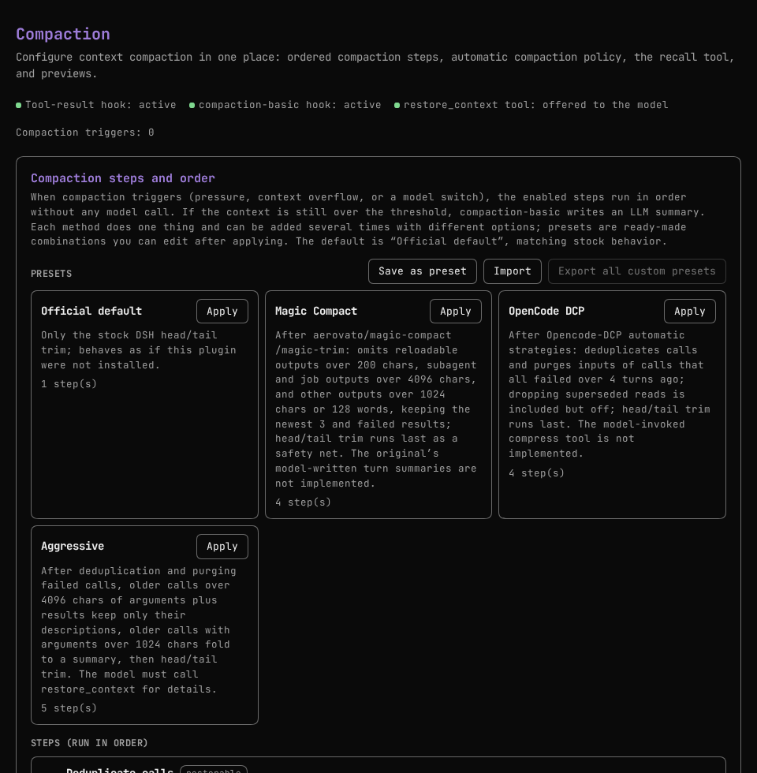

# dsh-compaction-manager

English | [中文](README.zh.md)

A DeepSeek Harness plugin that puts context compaction in one panel:

- **Ordered compaction steps.** When compaction triggers, the enabled steps run in the configured order. None of them calls a model. If the context is still over the threshold afterwards, `compaction-basic` writes its LLM summary as the fixed last step.
- **Automatic compaction settings.** `compaction-basic` thresholds, retention, retries, summary model, and an auto on/off switch, applied at the next compaction without a restart.
- **Recall.** Hidden content carries an id. The model can call `restore_context` to read the original back from the session log.
- **Preview.** Simulates the edited steps on any session and shows per-item before/after text and estimated token savings. Nothing is written.

The default configuration behaves exactly like stock DSH: only the official head/tail pruner runs, and it delegates to the original implementation.




## Install

Requires DeepSeek Harness `>=0.2.2-rc.1 <0.3.0`.

```sh
dsh plugin --profile web add github:RickT34/dsh-compaction-manager
```

Or in the Web app: **Plugins → Add plugin**, enter `github:RickT34/dsh-compaction-manager`. The panel appears in the sidebar as **Compaction**, and on the plugin's page under **Plugins**.

## Built-in methods

| Method | What it hides | Restorable | Default |
|---|---|---|---|
| Official head/tail trim | Middle of tool results over 8192 chars | Only with "Include recall id" | On |
| Magic Compact | Old bulky tool outputs, replaced with an omission notice (after aerovato/magic-compact `/magic-trim`) | Yes | Off |
| OpenCode DCP | Duplicate calls, errored call inputs after N turns, optionally superseded reads (after Opencode-DCP) | Yes | Off |
| Fold old tool calls | Whole call groups, including arguments such as file bodies in `write`/`edit` | Yes | Off |

Folding replaces a closed assistant tool-call message and its results with one user message, because DSH does not allow rewriting tool-call arguments on their own.

## How it hooks in

The Web app mounts `compaction-basic` and `tool-result-pruner` inside each agent preset. This plugin wraps their prototypes while it is loaded:

- `ToolResultPruner.prototype.pruneSession` runs the configured steps.
- `BasicCompactionEngine.prototype` methods apply panel overrides of the compaction policy.

Unloading the plugin restores the originals. Every replacement uses the same replay-safe events as the official pruner (`compaction/prune` followed by a surface `replace`), so sessions stay readable without this plugin.

## Extending

Other plugins can add methods:

```js
export const inject = ['compactionMethods']
export function apply(ctx) {
  ctx.effect(() => ctx.compactionMethods.register({
    id: 'my-method',
    name: { zh: '我的方法', en: 'My method' },
    summary: { zh: '…', en: '…' },
    details: { zh: '…', en: '…' },
    options: [{ key: 'minChars', type: 'number', label: { en: 'Min chars' }, default: 500 }],
    recall: () => true,
    // view.nodes: [{ seq, rootSeq, type, text, chars, toolName, args, isError, pending, turn, ... }]
    plan(view, options) {
      return view.nodes
        .filter(n => n.type === 'tool' && !n.pending && n.chars > options.minChars)
        .map(n => ({ type: 'result', seq: n.seq, content: [{ type: 'text', text: `[compacted · id=r${n.rootSeq}] …` }] }))
    },
  }))
}
```

`plan` must be pure. Candidates are `{ type: 'result', seq, content }` (rewrite one tool result) or `{ type: 'fold', startSeq, endSeq, content }` (replace a closed tool-call group with a user message). Notices that start with `[compacted` are skipped by the built-in methods; ids `r<seq>` and `c<seq>` work with `restore_context`.

## Development

```sh
npm run link-dsh   # link DSH packages from the local `dsh` installation (needed by the tests)
npm test           # node --test test/*.test.mjs
npm run build      # regenerates dist/client.js from src/client/*.js
```

`dist/client.js` is committed so that installing from GitHub needs no build step. Rebuild and commit it after changing `src/client/`.

## License

[MIT](LICENSE)
