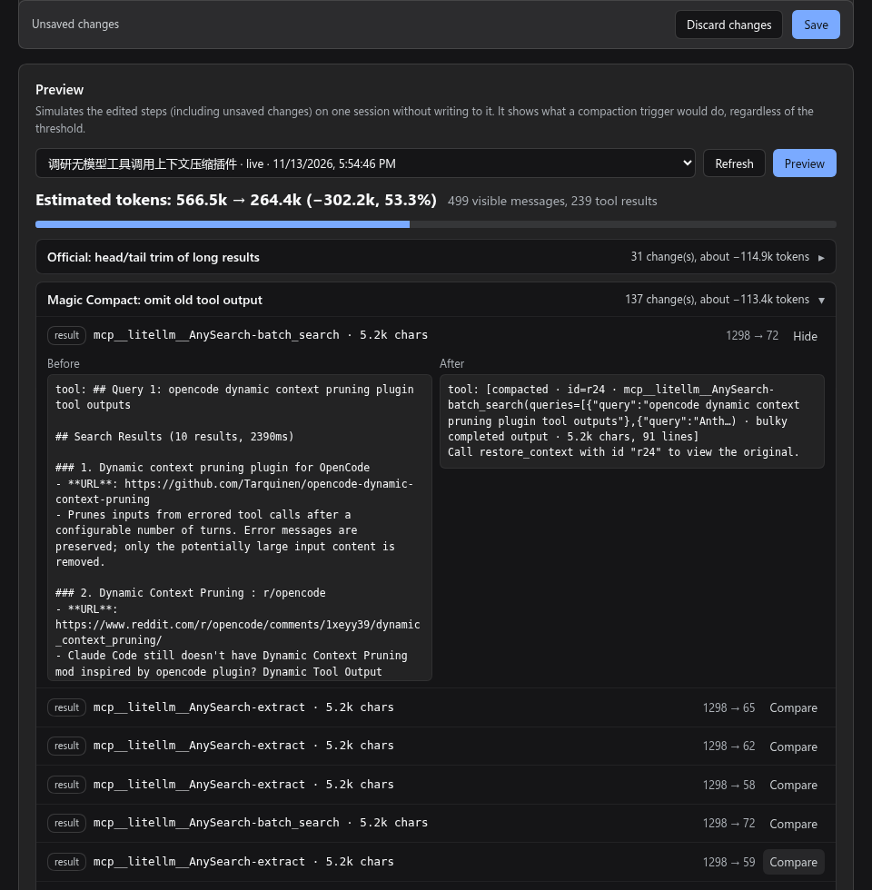

# dsh-compaction-manager

English | [中文](README.zh.md)

A DeepSeek Harness plugin that puts context compaction in one panel:

- **Ordered compaction steps.** When compaction triggers, the enabled steps run in the configured order. None of them calls a model. If the context is still over the threshold afterwards, `compaction-basic` writes its LLM summary as the fixed last step.
- **Automatic compaction settings.** `compaction-basic` thresholds, retention, retries, summary model, and an auto on/off switch, applied at the next compaction without a restart.
- **Recall.** Hidden content carries an id. The model can call `restore_context` to read the original back from the session log.
- **Preview and compact now.** Each session gets a **Compaction** tab next to Chat and Trajectory. It previews the saved steps on that session, with per-item before/after text and estimated token savings, and has a **Compact now** button. DSH rewrites history only inside a model turn, so compact now runs right before the session's next model call.

The default configuration behaves exactly like stock DSH: only the official head/tail pruner runs, and it delegates to the original implementation.




## Install

Requires DeepSeek Harness `>=0.2.2-rc.1 <0.3.0`.

```sh
dsh plugin --profile web add dsh-compaction-manager
```

Or in the Web app: **Plugins → Add plugin**, enter `dsh-compaction-manager`. The panel appears in the sidebar as **Compaction**, and on the plugin's page under **Plugins**.

To install the latest commit from GitHub instead of the npm release, use `github:RickT34/dsh-compaction-manager`.

## Methods and presets

Each method does one kind of change with one selection rule. A step is one method with its own options and tool scope (`tools` / `excludeTools`); the same method can appear in several steps.

| Method | What it does | Restorable |
|---|---|---|
| Head/tail trim | Keeps the head and tail of results over 8192 chars; identical to the official pruner with default options | Only with "Include recall id" |
| Omit output | Replaces older results over a character or word threshold with a one-line notice | Yes |
| Deduplicate calls | Keeps only the newest result of calls with identical tool and arguments | Yes |
| Drop superseded reads | Replaces a read made stale by a later write, edit, or full read of the same path | Yes |
| Purge failed calls | Folds call groups that all failed some turns ago into tool name, description, and error | Yes |
| Fold tool calls | Replaces an older call group (arguments and results) over a threshold with text; detail level is a summary or the description only | Yes |

Every notice keeps the call's `description` argument in full.

Presets are ready-made step lists. Applying one replaces the steps, which you can then edit. **Save as preset** stores the steps being edited as a custom preset (saving under an existing custom name replaces it), and custom presets can be deleted. **Export** writes one or all custom presets to a JSON file; **Import** reads such a file back, validates every step, and adds the presets that pass, renaming any name that already exists.

| Preset | Steps |
|---|---|
| Official default (default) | Head/tail trim. Behaves exactly like stock DSH. |
| Magic Compact | Omit output three times (reloadable tools over 200 chars, subagent and job tools over 4096, others over 1024 chars or 128 words), then head/tail trim. After aerovato/magic-compact `/magic-trim`. |
| OpenCode DCP | Deduplicate, drop superseded reads (off), purge failed calls after 4 turns, head/tail trim. After Opencode-DCP. |
| Aggressive | Deduplicate, purge failed calls, fold calls over 4096 chars to descriptions only, fold calls with arguments over 1024 chars to a summary, head/tail trim. |

Folding replaces a closed assistant tool-call message and its results with one user message, because DSH does not allow rewriting tool-call arguments on their own. Pipelines saved by 0.1.x are migrated to the equivalent steps when read.

## How it hooks in

The Web app mounts `compaction-basic` and `tool-result-pruner` inside each agent preset. This plugin wraps their prototypes while it is loaded:

- `ToolResultPruner.prototype.pruneSession` runs the configured steps.
- `BasicCompactionEngine.prototype` methods apply panel overrides of the compaction policy.

Unloading the plugin restores the originals. Every replacement uses the same replay-safe events as the official pruner (`compaction/prune` followed by a surface `replace`), so sessions stay readable without this plugin.

## Extending

Other plugins can add methods and presets:

```js
export const inject = ['compactionMethods']
export function apply(ctx) {
  ctx.effect(() => ctx.compactionMethods.register({
    id: 'my-method',
    name: { zh: '我的方法', en: 'My method' },
    summary: { zh: '…', en: '…' },
    details: { zh: '…', en: '…' },
    options: [{ key: 'minChars', type: 'number', label: { en: 'Min chars' }, default: 500 }],
    recall: () => true,
    // view.nodes: [{ seq, rootSeq, type, text, chars, toolName, args, isError, pending, turn, ... }]
    plan(view, options) {
      return view.nodes
        .filter(n => n.type === 'tool' && !n.pending && n.chars > options.minChars)
        .map(n => ({ type: 'result', seq: n.seq, content: [{ type: 'text', text: `[compacted · id=r${n.rootSeq}] …` }] }))
    },
  }))
  ctx.effect(() => ctx.compactionMethods.registerPreset({
    id: 'my-preset',
    name: { zh: '我的预设', en: 'My preset' },
    summary: { zh: '…', en: '…' },
    steps: [{ method: 'dedupe' }, { method: 'my-method', options: { minChars: 2000 } }],
  }))
}
```

`plan` must be pure. Candidates are `{ type: 'result', seq, content }` (rewrite one tool result) or `{ type: 'fold', startSeq, endSeq, content }` (replace a closed tool-call group with a user message). Notices that start with `[compacted` are skipped by the built-in methods; ids `r<seq>` and `c<seq>` work with `restore_context`.

## Development

```sh
npm run link-dsh   # link DSH packages from the local `dsh` installation (needed by the tests)
npm test           # node --test test/*.test.mjs
npm run build      # regenerates dist/client.js from src/client/*.js
```

`dist/client.js` is committed so that installing from GitHub needs no build step. Rebuild and commit it after changing `src/client/`.

## License

[MIT](LICENSE)
