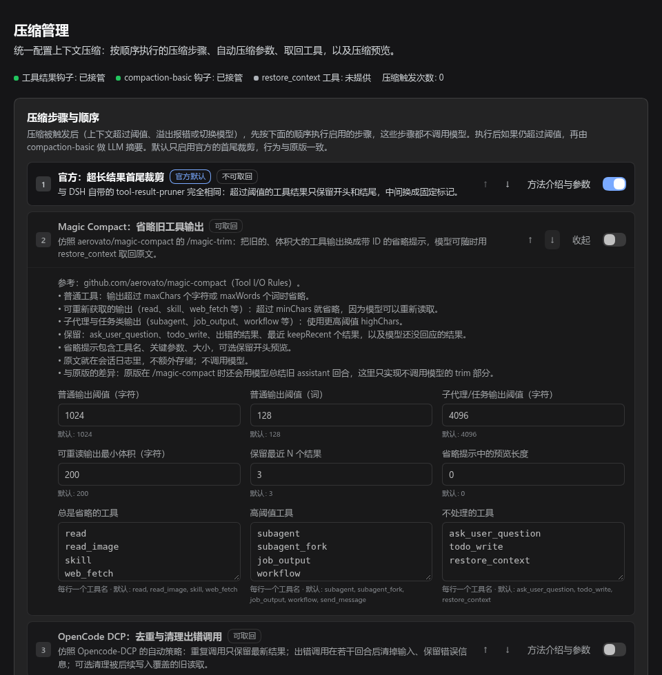

# dsh-compaction-manager

[English](README.md) | 中文

一个 DeepSeek Harness 插件，在一个面板里统一管理上下文压缩：

- **按顺序执行的压缩步骤。** 压缩触发后，启用的步骤按配置的顺序执行，都不调用模型。执行完如果上下文仍超过阈值，再由 `compaction-basic` 做 LLM 摘要，这一步固定在最后。
- **自动压缩参数。** 可以调整 `compaction-basic` 的触发阈值、保留比例、重试次数、摘要模型和自动压缩开关，下一次压缩时生效，不用重启。
- **取回原文。** 被隐藏的内容带一个 ID，模型可以调用 `restore_context` 从会话日志里读回原文。
- **压缩预览与立即压缩。** 每个会话顶部多了一个「压缩」标签，和「对话」「轨迹」并列。它用已保存的步骤预览这个会话的压缩效果，逐条显示压缩前后的文字和估算节省的 token，并提供「立即压缩」按钮。DSH 只允许在模型回合内改写历史，所以立即压缩会在这个会话下一次调用模型前执行。

默认配置与原版 DSH 完全一致：只运行官方的首尾裁剪，并且直接调用官方原来的实现。





## 安装

需要 DeepSeek Harness `>=0.2.2-rc.1 <0.3.0`。

```sh
dsh plugin --profile web add dsh-compaction-manager
```

也可以在 Web 界面里打开**插件 → 添加插件**，输入 `dsh-compaction-manager`。安装后左侧栏会出现**压缩管理**，**插件**页里这个插件的详情页也有打开面板的入口。

如果想装 GitHub 上的最新提交而不是 npm 发布版，把包名换成 `github:RickT34/dsh-compaction-manager`。

## 方法与预设

每种方法只做一件事，用一条规则挑选处理对象。一个步骤就是一种方法加上它自己的参数和工具范围（`tools` / `excludeTools`），同一种方法可以出现在多个步骤里。

| 方法 | 做什么 | 能否取回 |
|---|---|---|
| 首尾裁剪 | 超过 8192 字符的结果只保留开头和结尾；默认参数下与官方裁剪完全相同 | 打开“附带取回 ID”后可以 |
| 省略输出 | 较早的、超过字符数或词数阈值的结果换成一行省略提示 | 能 |
| 重复调用去重 | 工具和参数完全相同的调用只保留最新一次的结果 | 能 |
| 清理被覆盖的读取 | 同一路径之后又被写入、编辑或完整读取时，清掉旧的读取结果 | 能 |
| 清理出错调用 | 若干回合前全部出错的一组调用，折叠成工具名、description 和错误信息 | 能 |
| 折叠工具调用 | 较早的一组调用（参数和结果）超过阈值时换成一段文字；保留级别可选摘要或仅 description | 能 |

所有省略提示都完整保留调用时写的 `description` 参数。

预设是现成的步骤组合。应用预设会替换当前步骤，之后可以继续修改。

| 预设 | 步骤 |
|---|---|
| 官方默认（默认） | 首尾裁剪。行为与原版 DSH 完全一致。 |
| Magic Compact | 三个省略输出步骤（可重新获取的工具超过 200 字符、子代理与任务类工具超过 4096、其他工具超过 1024 字符或 128 个词），最后首尾裁剪。仿照 aerovato/magic-compact 的 `/magic-trim`。 |
| OpenCode DCP | 去重、清理被覆盖的读取（关闭）、清理 4 个回合前的出错调用、首尾裁剪。仿照 Opencode-DCP。 |
| 激进 | 去重、清理出错调用、超过 4096 字符的旧调用只保留 description、参数超过 1024 字符的旧调用折叠成摘要、首尾裁剪。 |

DSH 不允许单独改写工具调用的参数，所以折叠会把一条已闭合的 assistant 工具调用消息和它的结果一起换成一条 user 消息。0.1.x 保存的配置在读取时会自动换成等效的步骤。

## 接入方式

Web 版把 `compaction-basic` 和 `tool-result-pruner` 装在每个 agent preset 内部。插件加载期间会替换它们原型上的方法：

- `ToolResultPruner.prototype.pruneSession`：执行配置好的压缩步骤。
- `BasicCompactionEngine.prototype` 上的方法：应用面板里填写的压缩参数。

卸载插件后会还原原来的方法。所有改写都使用和官方裁剪相同、可安全重放的事件（先写 `compaction/prune`，再做一次 surface `replace`），所以卸载插件后这些会话照样能正常打开。

## 扩展

其他插件可以注册新的压缩方法和预设：

```js
export const inject = ['compactionMethods']
export function apply(ctx) {
  ctx.effect(() => ctx.compactionMethods.register({
    id: 'my-method',
    name: { zh: '我的方法', en: 'My method' },
    summary: { zh: '…', en: '…' },
    details: { zh: '…', en: '…' },
    options: [{ key: 'minChars', type: 'number', label: { zh: '最小字符数', en: 'Min chars' }, default: 500 }],
    recall: () => true,
    // view.nodes: [{ seq, rootSeq, type, text, chars, toolName, args, isError, pending, turn, ... }]
    plan(view, options) {
      return view.nodes
        .filter(n => n.type === 'tool' && !n.pending && n.chars > options.minChars)
        .map(n => ({ type: 'result', seq: n.seq, content: [{ type: 'text', text: `[compacted · id=r${n.rootSeq}] …` }] }))
    },
  }))
  ctx.effect(() => ctx.compactionMethods.registerPreset({
    id: 'my-preset',
    name: { zh: '我的预设', en: 'My preset' },
    summary: { zh: '…', en: '…' },
    steps: [{ method: 'dedupe' }, { method: 'my-method', options: { minChars: 2000 } }],
  }))
}
```

`plan` 必须是纯函数，不能修改任何东西。它返回的候选项有两种：

- `{ type: 'result', seq, content }`：改写一条工具结果。
- `{ type: 'fold', startSeq, endSeq, content }`：把一组已闭合的工具调用换成一条 user 消息。

内置方法会跳过以 `[compacted` 开头的提示。`r<seq>` 和 `c<seq>` 形式的 ID 都可以传给 `restore_context`。注册后，新方法会自动出现在面板里，可以排序、调整参数和预览。

## 开发

```sh
npm run link-dsh   # 从本机的 dsh 安装链接测试需要的 DSH 包
npm test           # node --test test/*.test.mjs
npm run build      # 用 src/client/*.js 重新生成 dist/client.js
```

`dist/client.js` 已提交到仓库，从 GitHub 安装时不需要构建。修改 `src/client/` 后，要重新构建并提交它。

## 许可证

[MIT](LICENSE)
