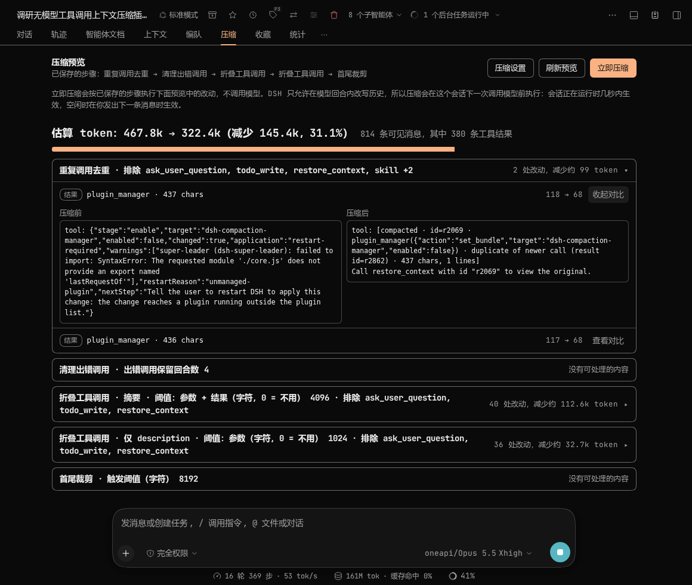

# dsh-compaction-manager

[English](README.md) | 中文

一个 DeepSeek Harness 插件，在一个面板里管理上下文压缩。你可以排列一组不调用模型的压缩步骤，调整官方的 LLM 摘要，并让模型取回被步骤隐藏的内容。

装上后不做任何配置，行为与原版 DSH 完全一致：唯一的步骤是官方的首尾裁剪，并且直接调用官方原来的实现。


## 安装

需要 DeepSeek Harness `>=0.2.2-rc.1 <0.3.0`。

```sh
dsh plugin --profile web add dsh-compaction-manager
```

也可以在 Web 界面里打开**插件 → 添加插件**，输入 `dsh-compaction-manager`。如果想装 GitHub 上的最新提交而不是 npm 发布版，把包名换成 `github:RickT34/dsh-compaction-manager`。

安装后：

- 左侧栏的**压缩管理**打开设置面板，**插件**页里这个插件的详情页也有入口。
- 每个会话顶部多一个**压缩**标签，和「对话」「轨迹」并列，里面是压缩预览和**立即压缩**按钮。

## 压缩如何执行

当请求会超过阈值、服务端报上下文溢出，或者切换模型时，DSH 会触发压缩。装上本插件后，压缩分两步：

1. **步骤。** 按顺序执行启用的步骤。每个步骤改写一些旧的工具结果或工具调用，都不调用模型。
2. **LLM 摘要。** 如果上下文仍超过阈值，由 `compaction-basic` 把最早的一段历史换成模型写的摘要。这一步固定在最后，参数可以在面板里调整（见[面板设置](#面板设置)）。

步骤留下的省略提示会完整保留调用时写的 `description` 参数，并带一个 ID。首尾裁剪例外：它不改调用本身，只有打开**附带取回 ID** 时才会加 ID。只要有启用的步骤会留下 ID，模型就能用 `restore_context` 工具按 ID 取回原文。

## 压缩方法

每种方法只做一件事，用一条规则挑选处理对象。一个步骤就是一种方法加上它自己的参数。同一种方法可以出现在多个步骤里，各用不同参数，例如 Magic Compact 预设就用了三个「省略输出」步骤，对不同的工具用不同的阈值。

大多数方法都有工具范围：**只处理这些工具**（留空表示全部）和**不处理这些工具**。「不处理这些工具」默认是 `ask_user_question`、`todo_write`、`restore_context`；「重复调用去重」还会跳过 `skill`、`subagent`、`subagent_fork`；首尾裁剪和官方一致，不跳过任何工具。「清理被覆盖的读取」不用这两个列表，而是用自己的读取工具和写入工具列表。

| 方法 | 做什么 | 主要参数（默认值） | 能否取回 |
|---|---|---|---|
| 首尾裁剪 | 超过阈值的结果只保留开头和结尾，中间换成固定标记。默认参数下与官方 `tool-result-pruner` 逐字节一致。 | 阈值 8192、开头 4096、结尾 1024 字符 | 打开**附带取回 ID** 后可以 |
| 省略输出 | 较早的、超过字符数或词数阈值的结果换成一行省略提示：工具名、关键参数、完整 description、大小、ID。 | 1024 字符，不按词数，保留最近 3 个，跳过出错的结果 | 能 |
| 重复调用去重 | 工具和参数完全相同的调用只保留最新一次的结果，旧结果换成指向它的占位。 | 最小 200 字符，保留最近 2 个 | 能 |
| 清理被覆盖的读取 | 同一路径之后又被写入、编辑或完整读取时，旧的读取结果换成占位。 | 读取工具 `read`；写入工具 `write`、`edit` | 能 |
| 清理出错调用 | 一组调用全部出错、且已经过去若干回合时，折叠成工具名、description 和错误信息。 | 4 个回合，保留最近 2 个 | 能 |
| 折叠工具调用 | 较早的一组调用（参数和结果一起）换成一段文字。**摘要**保留关键参数、状态、大小和每个结果的开头；**仅 description** 只保留每个调用的工具名和 description。 | 总长度超过 8192 字符，或参数超过 1024 字符；保留最近 4 组 | 能 |

DSH 不允许单独改写工具调用的参数，所以「清理出错调用」和「折叠工具调用」会把一条已闭合的 assistant 工具调用消息和它的结果一起换成一条 user 消息。之后模型不再看到这组调用的原生 tool-call 结构，其中的推理块也会失效。

模型还没回应的结果不会被处理。唯一的例外是首尾裁剪，它和官方一致，处理所有结果。

## 预设

预设是现成的步骤组合。点**应用**会替换当前步骤，保存前可以继续修改。与当前步骤一致的预设会标出**当前**。

| 预设 | 步骤 |
|---|---|
| 官方默认（默认） | 首尾裁剪。 |
| Magic Compact | 对 `read`、`read_image`、`skill`、`web_fetch` 超过 200 字符的输出做省略；对子代理与任务类工具超过 4096 字符的输出做省略；对其他工具超过 1024 字符或 128 个词的输出做省略；首尾裁剪。仿照 [aerovato/magic-compact](https://github.com/aerovato/magic-compact) 中不调用模型的 `/magic-trim` 规则。 |
| OpenCode DCP | 去重；清理被覆盖的读取（关闭）；清理 4 个回合前的出错调用；首尾裁剪。仿照 [Opencode-DCP](https://github.com/Tarquinen/opencode-dynamic-context-pruning) 的自动策略。 |
| 激进 | 去重；清理出错调用；超过 4096 字符的旧调用只保留 description；参数超过 1024 字符的旧调用折叠成摘要；首尾裁剪。 |

Magic Compact 和 OpenCode DCP 都不是完整移植：原项目中调用模型的部分（Magic Compact 的回合摘要、DCP 的 `compress` 工具）没有实现。

### 自定义预设

- **保存为预设**：把正在编辑的步骤（包括未保存的修改）存成预设，需要填名称，说明可选。和已有的自定义预设同名时会覆盖它。
- **删除**：在自定义预设上点「删除」，再点一次确认才会删除。
- **导出**：自定义预设卡片上的「导出」下载这一个预设的 JSON 文件；「导出全部自定义预设」下载所有。
- **导入**：读取这样的文件，逐个校验预设，把通过的加进来。名称重复时会在后面加编号，没通过的会逐条列出原因。

保存、删除和导入会立即写入设置，和步骤草稿分开。内置预设不能删除，也不能导出；想分享的话，先应用、再用自己的名字保存。

文件格式：

```json
{
  "format": "dsh-compaction-manager.presets",
  "version": 1,
  "presets": [
    {
      "name": "提前省略读取",
      "summary": "read 输出超过 500 字符就省略，最后官方裁剪。",
      "steps": [
        { "method": "omit-output", "options": { "tools": ["read"], "minChars": 500 } },
        { "method": "trim-head-tail" }
      ]
    }
  ]
}
```

也接受预设数组，或单个预设对象。导入的限制：文件不超过 200 KB，每个文件最多 50 个预设，每个预设最多 50 个步骤，名称最长 60 字，说明最长 400 字。步骤参数必须符合对应方法的规则。用到了没安装的插件提供的方法时，预设仍会导入，但会给出提示。

## 面板设置

- **压缩步骤与顺序**：内置预设、自定义预设和步骤列表。步骤可以添加、删除、排序、启用和调整参数。点**保存**后在下一次压缩时生效，不用重启。
- **自动压缩参数（compaction-basic）**：自动压缩开关、`thresholdRatio`、`retainRatio` 或 `retainTokens`、`headroomTokens`、摘要的 `maxTokens`、摘要重试次数、溢出恢复次数，以及摘要模型的提供方和模型。留空表示使用官方值，占位文字显示当前生效的值。关闭自动压缩也会停用溢出恢复，手动 `/compact` 仍然可用。
- **取回工具 restore_context**：*自动*表示只有启用的步骤会留下 ID 时才提供这个工具；*总是提供*和*从不提供*会覆盖这个判断。
- **最近执行**：最近 20 次执行，显示每个步骤改了几处，以及估算节省的 token。

## 会话标签：预览与立即压缩



**压缩**标签用已保存的步骤模拟压缩当前会话，不写入任何内容。它显示压缩前后的估算 token 数，以及每个步骤会做的每一处改动，可以展开对比改动前后的文字。

**立即压缩**按预览执行这些改动，不调用模型。DSH 只接受在模型回合内改写历史，所以点击后会先排队，在这个会话下一次调用模型前执行：会话运行中时几秒内生效，空闲时在你发出下一条消息时生效。排队中可以取消。立即压缩只执行步骤，需要 LLM 摘要时请用 `/compact`。

## restore_context

```text
restore_context(id, offset?, max_chars?)
```

- `id` 是 `r<seq>`（一条工具结果）或 `c<seq>`（一组被折叠的工具调用）。
- 返回会话日志里的原文，从 `offset` 开始，最多 `max_chars` 个字符（1–60000，默认 20000）。内容更长时，会告诉模型下一次该用哪个 offset。
- 只读，不额外存储任何东西，原文本来就在会话日志里。

## 接入方式

Web 版把 `compaction-basic` 和 `tool-result-pruner` 装在每个 agent preset 内部，其他插件替换不了这两个服务。所以本插件在加载期间替换它们原型上的方法：

- `ToolResultPruner.prototype.pruneSession`：执行配置好的步骤。步骤恰好是默认值时，直接调用原来的方法，不做任何改动。
- `BasicCompactionEngine.prototype` 上的方法：应用面板里填写的压缩参数。没有填写时，原样使用引擎自己的配置。

卸载插件后会还原原来的方法。所有改写都使用和官方裁剪相同、可安全重放的事件（先写 `compaction/prune`，再做一次 surface `replace`），所以卸载插件后这些会话照样能正常打开。0.1.x 保存的配置把预设当作方法，读取时会自动换成等效的步骤。

## 扩展

其他插件可以通过 `compactionMethods` 服务注册方法和预设，两个调用都会返回一个用于注销的函数。

```js
export const inject = ['compactionMethods']

export function apply(ctx) {
  ctx.effect(() => ctx.compactionMethods.register({
    id: 'my-method',
    name: { zh: '我的方法', en: 'My method' },
    summary: { zh: '…', en: '…' },
    details: { zh: '…', en: '…' },
    options: [{ key: 'minChars', type: 'number', label: { zh: '最小字符数', en: 'Min chars' }, default: 500 }],
    tagKeys: ['minChars'],          // 显示在步骤卡片上的参数
    recall: () => true,             // 这个方法是否会留下 restore_context 的 ID
    plan(view, options) {
      return view.nodes
        .filter(n => n.type === 'tool' && !n.pending && n.chars > options.minChars)
        .map(n => ({ type: 'result', seq: n.seq, content: [{ type: 'text', text: `[compacted · id=r${n.rootSeq}] …` }] }))
    },
  }))

  ctx.effect(() => ctx.compactionMethods.registerPreset({
    id: 'my-preset',
    name: { zh: '我的预设', en: 'My preset' },
    summary: { zh: '…', en: '…' },
    steps: [{ method: 'dedupe' }, { method: 'my-method', options: { minChars: 2000 } }],
  }))
}
```

- 参数类型有 `number`、`boolean`、`string`、`list`、`select`，面板会按这些声明生成表单。
- `view.nodes` 按顺序列出模型可见的消息。每个节点有 `seq`、`rootSeq`、`type`（`user`、`assistant`、`tool` 等）、`text`、`chars`、`turn`；工具结果节点另有 `toolName`、`args`、`isError`、`pending`。
- `plan` 不能修改任何东西，它返回两种候选项：
  - `{ type: 'result', seq, content }`：改写一条工具结果。
  - `{ type: 'fold', startSeq, endSeq, content }`：把一组已闭合的工具调用换成一条 user 消息。
- 内置方法会跳过以 `[compacted` 开头的内容。使用 `r<rootSeq>` 和 `c<rootSeq>` 形式 ID 的提示可以配合 `restore_context` 使用。

## 开发

```sh
npm run link-dsh   # 从本机的 dsh 安装链接测试需要的 DSH 包
npm test           # node --test test/*.test.mjs
npm run build      # 用 src/client/*.js 重新生成 dist/client.js
```

| 路径 | 内容 |
|---|---|
| `src/core.js` | 可见消息视图、候选项模拟、提示文字、预览 |
| `src/methods.js` | 内置方法 |
| `src/presets.js` | 内置预设和 0.1.x 配置迁移 |
| `src/user-presets.js` | 自定义预设的校验、保存和导入导出 |
| `src/registry.js` | 方法和预设的注册表、步骤列表规范化 |
| `src/integration.js` | 对官方压缩类的方法替换 |
| `src/host.js` | 设置项、HTTP 接口、`restore_context`、立即压缩 |
| `src/client/` | 面板和会话标签（构建为 `dist/client.js`） |

`dist/client.js` 已提交到仓库，从 GitHub 安装时不需要构建。修改 `src/client/` 后，要重新构建并提交它。

## 许可证

[MIT](LICENSE)
